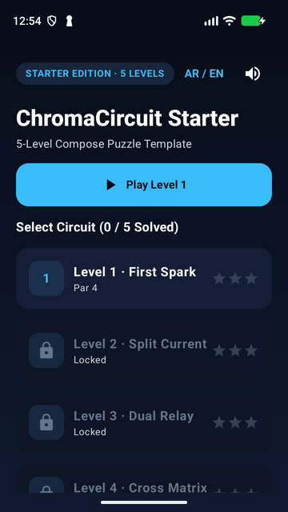
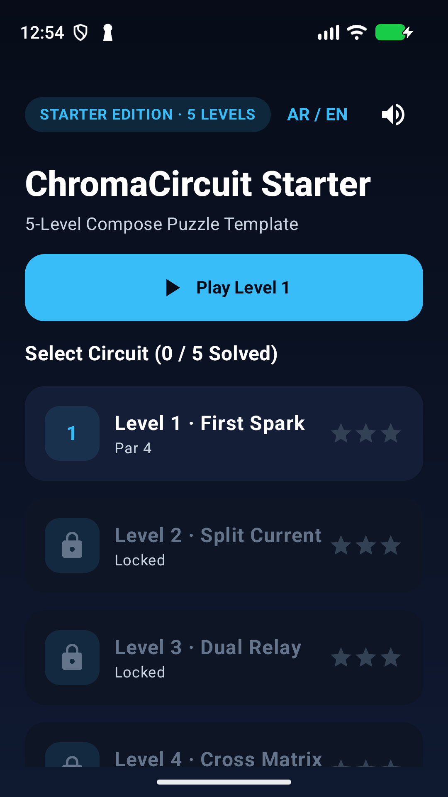

# ChromaCircuit Starter — Android Kotlin & Jetpack Compose Puzzle Template (5 Levels)

A clean, modern **5-Level Conduit Puzzle Game Starter** built 100% with **Kotlin**, **Jetpack Compose (Material 3)**, and procedural **Compose Canvas** rendering — designed to let Android developers inspect and run a real dual-flavor game architecture in minutes.



## Included in This Free 5-Level Starter
- **5 Curated Levels (3x3 to 5x5):** Graph-connectivity BFS engine (`PuzzleEngine.kt`), par-move calculation, Hint solver (`findNextHint`), Undo stack, and 1–3 star progression.
- **100% Procedural Compose Canvas & Vector Art:** Zero raster PNG/WebP game assets or external font binaries; adaptive XML vector launcher icon (`ic_launcher_*.xml`).
- **100% Procedural Kotlin `AudioTrack` PCM SFX:** Synthesizes tap, conduit lock, undo, and victory chimes mathematically in pure Kotlin (`SoundEngine.kt`) — zero bundled `.ogg`/`.mp3`/`.wav` files.
- **Dual Build Flavors (`store` dimension):**
  - `noAds`: Compiles cleanly with zero AdMob SDKs, zero `INTERNET` permission, and zero `AD_ID` permission.
  - `withAds`: Google AdMob Banner, paced Interstitial, and Rewarded Hint integration wired with official Google **TEST IDs** only (`withAds/res/values/admob.xml`).
- **Full English & Arabic (RTL) Parity:** Every UI string is localized cleanly in `values/strings.xml` and `values-ar/strings.xml` with live in-app switching.
- **Pure-JVM Unit Tests:** `PuzzleEngineTest.kt` validates rotation symmetry, un-solved start states, and hint solvability for all 5 levels.

---

## Screenshots

| Home & Level Select | Active Puzzle & Hint | Victory Dialog |
|---|---|---|
|  |  |  |

---

## Try the Prebuilt APK
Download the ready-to-install debug APK directly from the **[Releases](https://github.com/simple-free-apps/android-compose-puzzle-starter/releases)** tab (`ChromaCircuitStarter-noAds-debug.apk`).

---

## Build Locally
Requires current stable Android Studio (or Gradle 9.6 / JDK 17 / Android SDK 37+):

```bash
# Run unit tests on both flavors
./gradlew :app:testNoAdsDebugUnitTest :app:testWithAdsDebugUnitTest

# Build ad-free and AdMob-test APKs
./gradlew :app:assembleNoAdsDebug :app:assembleWithAdsDebug
```

> **Quick Package Rename:** Update `applicationId` and `namespace` in `app/build.gradle.kts`, and replace the official Google **TEST** IDs in `app/src/withAds/res/values/admob.xml` with your live AdMob IDs before production signing.

---

## Starter vs. Full Commercial Pack (Puzzle Pack 5-in-1 — $12)

> **Verified test evidence:** the commercial Puzzle Pack passed 57/57 unit tests, with QA across three Android device profiles. This free starter is a separate five-level sample and its included `PuzzleEngineTest.kt` covers its own five levels.

| Feature | ChromaCircuit Starter (This Repo) | Soravel: Puzzle Pack 5-in-1 (Full Studio Kit) |
|---|---|---|
| **Included Games** | 1 Sample Mechanic | **5 Full Distinct Puzzle Games** (LanternLoom, PillarGlide, Tessavora, Kivorivane, Trelovix) |
| **Total Levels** | 5 Curated Levels | **1,928+ Campaign Levels** + Endless, Daily, Workshop & AI Duel |
| **Audio** | Procedural Kotlin PCM Beeps | **34 Commercial-Plan In-App `.ogg` SFX & Music** (`CREDITS.md` terms) |
| **Verification** | JUnit Starter Tests | **57/57 Verified Unit Tests** + Multi-Device Redroid QA |
| **Reskin Docs** | README Quick Start | **Complete Offline EN & AR HTML Reskin Guides** |
| **Price** | Free (Non-Resale Starter) | **$12 Instant Download on Payhip** ([Get the full pack](https://payhip.com/b/beFfj?utm_source=github&utm_medium=readme&utm_campaign=chromacircuit_starter)) |

**Live Published Android Demos (from our catalog on Google Play):**
- [Liquid Sort Puzzle on Google Play](https://play.google.com/store/apps/details?id=com.gr8.games.liquidsortpuzzle&utm_source=github&utm_medium=readme&utm_campaign=chromacircuit_starter)
- [Orvaleth: Clockwork Spires on Google Play](https://play.google.com/store/apps/details?id=com.valkora.serenth.orvaleth&utm_source=github&utm_medium=readme&utm_campaign=chromacircuit_starter)

---

## License
Distributed under the **ChromaCircuit Starter Evaluation & Learning License** ([LICENSE](LICENSE)). You may study, run, and build a single substantially customized app, **but you may not resell, redistribute, or republish this template as-is on code marketplaces or app stores**.
