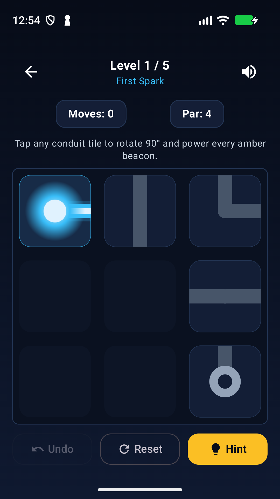
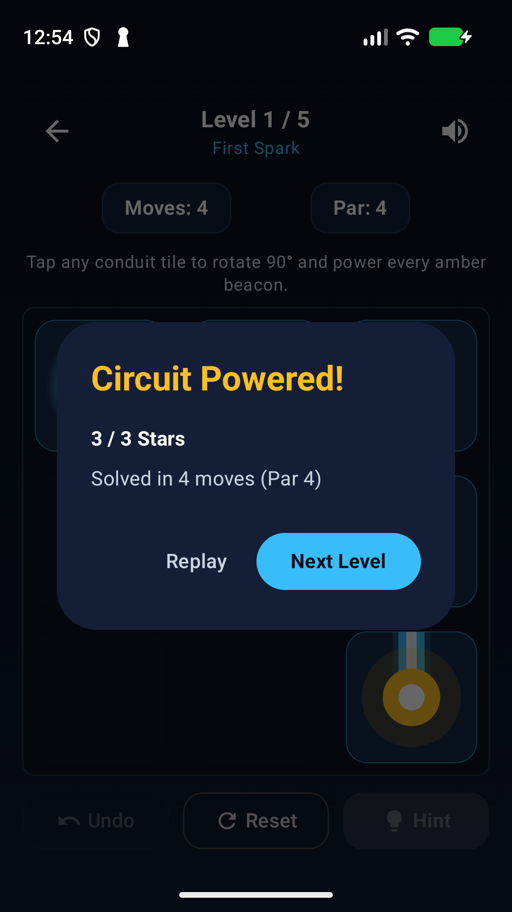

# ChromaCircuit Starter — Android Kotlin & Jetpack Compose Puzzle Template (5 Levels)

A clean, modern **5-Level Conduit Puzzle Game Starter** built 100% with **Kotlin**, **Jetpack Compose (Material 3)**, and procedural **Compose Canvas** rendering — designed to let Android developers inspect and run a real dual-flavor game architecture in minutes.


## Included in This Free 5-Level Starter
- **5 Curated Levels (3x3 to 5x5):** Graph-connectivity BFS engine (`PuzzleEngine.kt`), par-move calculation, Hint solver (`findNextHint`), Undo stack, and 1–3 star progression.
- **100% Procedural Compose Canvas & Vector Art:** Zero raster PNG/WebP game assets or external font binaries; adaptive XML vector launcher icon (`ic_launcher_*.xml`).
- **100% Procedural Kotlin `AudioTrack` PCM SFX:** Synthesizes tap, conduit lock, undo, and victory chimes mathematically in pure Kotlin (`SoundEngine.kt`) — zero bundled `.ogg`/`.mp3`/`.wav` files.
- **Dual Build Flavors (`store` dimension):**
  - `noAds`: Compiles cleanly with zero AdMob SDKs, zero `INTERNET` permission, and zero `AD_ID` permission.
  - `withAds`: Google AdMob Banner, paced Interstitial, and Rewarded Hint integration wired with official Google **TEST IDs** only (`withAds/res/values/admob.xml`).
- **Full English & Arabic (RTL) Parity:** Every UI string is localized cleanly in `values/strings.xml` and `values-ar/strings.xml` with live in-app switching.
- **Pure-JVM Unit Tests:** `PuzzleEngineTest.kt` validates rotation symmetry, un-solved start states, and hint solvability for all 5 levels.

---

## Screenshots

| Home & Level Select | Active Puzzle & Hint | Victory Dialog |
|---|---|---|
|  |  |  |

---

## Try the Live Demos & Prebuilt APK
- **[Play Interactive Puzzle Demos in Your Browser](https://simple-free-apps.github.io/demo/?utm_source=android-compose-puzzle-starter&utm_medium=readme&utm_campaign=live_demo)** (Liquid Sort, LanternLoom optical beams, Kivorivane kite escape)
- Download the ready-to-install debug APK from **[Releases](https://github.com/simple-free-apps/android-compose-puzzle-starter/releases)** (`ChromaCircuitStarter-noAds-debug.apk`).
- Want the standalone MIT audio synthesizer used in this pattern? See **[compose-pcm-sfx (MIT)](https://github.com/simple-free-apps/compose-pcm-sfx)**.

---

## Build Locally
Requires current stable Android Studio (or Gradle 9.6 / JDK 17 / Android SDK 37+):

```bash
# Run unit tests on both flavors
./gradlew :app:testNoAdsDebugUnitTest :app:testWithAdsDebugUnitTest

# Build ad-free and AdMob-test APKs
./gradlew :app:assembleNoAdsDebug :app:assembleWithAdsDebug
```

> **Quick Package Rename:** Update `applicationId` and `namespace` in `app/build.gradle.kts`, and replace the official Google **TEST** IDs in `app/src/withAds/res/values/admob.xml` with your live AdMob IDs before production signing.

---

## Starter vs. Full Commercial Pack (Soravel: Puzzle Pack 5-in-1 — $14 on Codester)

> **Verified test evidence:** the commercial Puzzle Pack passed 54/54 unit tests, with QA across three Android device profiles. This free starter is a separate five-level sample and its included `PuzzleEngineTest.kt` covers its own five levels.

| Feature | ChromaCircuit Starter (This Repo) | Soravel: Puzzle Pack 5-in-1 (Full Studio Kit) |
|---|---|---|
| **Included Games** | 1 Sample Mechanic | **5 Full Distinct Puzzle Games** (LanternLoom, PillarGlide, Tessavora, Kivorivane, Trelovix) |
| **Total Levels** | 5 Curated Levels | **1,928+ Campaign Levels** + Endless, Daily, Workshop & AI Duel |
| **Audio** | Procedural Kotlin PCM Beeps | **34 Commercial-Plan In-App `.ogg` SFX & Music** (`CREDITS.md` terms) |
| **Verification** | JUnit Starter Tests | **54/54 Verified Unit Tests** + Multi-Device Redroid QA |
| **Reskin Docs** | README Quick Start | **Complete Offline EN & AR HTML Reskin Guides** |
| **Price** | Free (Evaluation Starter) | **$14 on Codester** ([Get the full pack](https://www.codester.com/items/76186/puzzle-pack-5-in-1-kotlin-android-game-bundle?ref=Gr8Man)) |

---

## More from Gr8 Apps & Games Studio

### Live Published Android Apps & Games on Google Play

These are standalone published apps (their source code is not offered for sale; the flagship games are free to play with optional in-app purchases and ads):

| App | Google Play |
|---|---|
| **Chess With Sara: Learn & Play** — Sara explains key moves by voice and text in EN/AR; 50,000 puzzles, online arenas, Chess960 & 12 Stockfish 18 levels | [Install](https://play.google.com/store/apps/details?id=com.gr8.games.chess.chesswithai&utm_source=android-compose-puzzle-starter&utm_medium=readme&utm_campaign=chesswithsara) |
| **Psycho Mechanics: Physics** — build chain-reaction machines with ramps, gears, magnets & a sandbox workshop (works offline) | [Install](https://play.google.com/store/apps/details?id=com.gr8.games.crazymachines&utm_source=android-compose-puzzle-starter&utm_medium=readme&utm_campaign=psychomechanics) |
| **Inkear: Offline Speech to Text** — on-device Whisper transcription in ~99 languages, one-time purchase, zero cloud upload | [Install](https://play.google.com/store/apps/details?id=com.gr8.app.inkear&utm_source=android-compose-puzzle-starter&utm_medium=readme&utm_campaign=inkear) |
| **Liquid Sort Puzzle** — fluid sorting puzzle with hidden layers & keyed flasks | [Install](https://play.google.com/store/apps/details?id=com.gr8.games.liquidsortpuzzle&utm_source=android-compose-puzzle-starter&utm_medium=readme&utm_campaign=liquid-sort) |
| **Orvaleth: Clockwork Spires** — 60 3D clockwork contraption levels | [Install](https://play.google.com/store/apps/details?id=com.valkora.serenth.orvaleth&utm_source=android-compose-puzzle-starter&utm_medium=readme&utm_campaign=orvaleth) |
| **Tessavora: Mosaic Puzzle** — 120 ceramic mosaic boards + 7x7 designer | [Install](https://play.google.com/store/apps/details?id=com.dralvoni.senvarek.tessavora&utm_source=android-compose-puzzle-starter&utm_medium=readme&utm_campaign=tessavora) |
| **PillarGlide: Tactical Slide** — 60 levels + Minimax AI duels | [Install](https://play.google.com/store/apps/details?id=com.brimavel.noruvik.pillarglide&utm_source=android-compose-puzzle-starter&utm_medium=readme&utm_campaign=pillarglide) |
| **LanternLoom: Light Path** — 48 optical conduit puzzles + hints | [Install](https://play.google.com/store/apps/details?id=com.tavrolin.quemsy.lanternloom&utm_source=android-compose-puzzle-starter&utm_medium=readme&utm_campaign=lanternloom) |
| **Kivorivane: Kite Escape** — 1,200 directional kite puzzles | [Install](https://play.google.com/store/apps/details?id=com.mirveki.savureth.kivorivane&utm_source=android-compose-puzzle-starter&utm_medium=readme&utm_campaign=kivorivane) |
| **Trelovix: Prism Grid** — 500 levels + Blitz + Daily Challenge | [Install](https://play.google.com/store/apps/details?id=com.vornalix.zelvarok.trelovix&utm_source=android-compose-puzzle-starter&utm_medium=readme&utm_campaign=trelovix) |
| **Zelquavex: Circuit Slide** — 1,200 relay circuit puzzles | [Install](https://play.google.com/store/apps/details?id=com.vorqali.nexumir.zelquavex&utm_source=android-compose-puzzle-starter&utm_medium=readme&utm_campaign=zelquavex) |
| **All 19 Live Google Play Apps** — full studio store (apps & games) | [Google Play Store](https://play.google.com/store/apps/dev?id=7078150569870376778) |

Explore the **[10 Source Kits Comparison & FAQ](https://simple-free-apps.github.io/source-kits/?utm_source=android-compose-puzzle-starter&utm_medium=readme&utm_campaign=matrix)**, **[Android games landing page](https://simple-free-apps.github.io/android-games/)**, or full **[Gr8 Studio catalog](https://simple-free-apps.github.io/?utm_source=android-compose-puzzle-starter&utm_medium=readme&utm_campaign=catalog)**.

### Commercial Source Kits (Codester & SellAnyCode)

| Project | Stack | Store Links |
|---|---|---|
| Soravel: Puzzle Pack 5-in-1 | Kotlin / Compose | [Codester · $14](https://www.codester.com/items/76186/puzzle-pack-5-in-1-kotlin-android-game-bundle?ref=Gr8Man) · [SellAnyCode · $29](https://www.sellanycode.com/item.php?id=28630) |
| Orvaleth: Clockwork Spires | Godot 4 / 3D | [Codester · $14](https://www.codester.com/items/76144/orvaleth-godot-3d-clockwork-puzzle-game?ref=Gr8Man) · [SellAnyCode · $20](https://www.sellanycode.com/item.php?id=28633) |
| Kivorivane (1,200 Levels) | Kotlin / Compose | [Codester · $14](https://www.codester.com/items/76093/kivorivane-1000-levels-kite-escape-kotlin?ref=Gr8Man) |
| Veyravel (Action Roguelite) | Godot 4 / 3D | [Codester · $14](https://www.codester.com/items/76079/veyravel-3d-android-action-game-godot?ref=Gr8Man) · [SellAnyCode · $20](https://www.sellanycode.com/item.php?id=28634) |
| Liquid Sort Puzzle | Kotlin / Compose | [Codester · $14](https://www.codester.com/items/64630/liquid-sort-puzzle-kotlin-android-game-template?ref=Gr8Man) · [SellAnyCode · $20](https://www.sellanycode.com/item.php?id=28631) |
| Zelquavex (ArrowEscape, 1,200) | Kotlin / Compose | [Codester · $14](https://www.codester.com/items/76106/zelquavex-1-200-circuit-puzzles-android?ref=Gr8Man) |
| Trelovix (NeonBlocks, 500) | Kotlin / Compose | [Codester · $14](https://www.codester.com/items/76112/trelovix-500-levels-block-puzzle-kotlin?ref=Gr8Man) |
| Tessavora (Mosaic, 120) | Kotlin / Compose | [Codester · $14](https://www.codester.com/items/76001/tessavora-mosaic-puzzle-android-game?ref=Gr8Man) |
| PillarGlide (Slide + AI Duels) | Kotlin / Compose | [Codester · $14](https://www.codester.com/items/75998/pillarglide-tactical-slide-game-kotlin?ref=Gr8Man) |
| LanternLoom (Light-Path) | Kotlin / Compose | [Codester · $14](https://www.codester.com/items/75956/lanternloom-light-path-puzzle-game-for-android?ref=Gr8Man) |

*Disclosure: Codester links above include the publisher's `?ref=Gr8Man` referral parameter, which may earn a referral commission at no extra cost to buyers. Store pages are authoritative for pricing, availability, and license terms.*

---

## License
Distributed under the **ChromaCircuit Starter Evaluation & Learning License** ([LICENSE](LICENSE)). You may study, run, and build a single substantially customized app, **but you may not resell, redistribute, or republish this template as-is on code marketplaces or app stores**.
